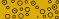

# DIN 4023 symbols and the data that draws them

One group = one variable of the borehole record (`docs/design/api-contract.md`): the value of that field picks the symbol.
How to draw the files is in [README.md](README.md); all values per group are in `din_codes.json`, `properties.json` and `left_symbols.json`.

| group | variable | example |
|---|---|---|
| lithology fill (Tables 1–3) | `stratigraphy[].din4023_code` | `"G"` → Kies / gravel, `#DBAB06`  |
| consistency / density (Table 6) | `stratigraphy[].consistency_density` | `"dense"` → dicht  |
| groundwater level (Table 5) | `groundwater[].type` | `"strike"` → struck  · `"rest"` → half-filled · `"standpipe"` → filled |
| groundwater rise / fall (Table 5) | two `groundwater[]` readings | strike 8.90 m, rest 7.90 m → rise  |
| cored section (Table 5) | `stratigraphy[].core` | `true` → double line over the layer  |
| samples (Table 5) | `test_results[].sample_depth_m` | `3.0` → box, bottom edge at 3.00 m  |
| weathering (Table 6) | no field yet | `w2_3` →  |
| jointing (Table 6) | no field yet | `jointed` →  |
| moisture (Table 6) | no field yet | wet →  |
| water sample (Table 5) | no field yet | →  |
| joint dip (Table 5) | no field yet | `135 / 25` →  rotated 135° |
