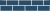

# DIN 4023 symbols and the data that draws them

One group = one variable of the borehole record (`docs/design/api-contract.md`): the value of that field picks the symbol.
Every category of a group is shown with one example. How to draw the files is in [README.md](README.md); all values are in `din_codes.json`, `properties.json` and `left_symbols.json`.

## Lithology fill — `stratigraphy[].din4023_code` (Tables 1–3)

| category | example |
|---|---|
| soil | `"G"` → Kies / gravel, `#DBAB06`  |
| rock | `"Kst"` → Kalkstein / limestone, `#2A4C67`  |
| geological | `"Mg"` → Geschiebemergel / till marl, `#41496C`  |

## Consistency / density — `stratigraphy[].consistency_density` (Table 6)

| category | example |
|---|---|
| consistency | `"stiff"` → halbfest  |
| density | `"dense"` → dicht  |

## Groundwater — `groundwater[].type` (Table 5)

| category | example |
|---|---|
| struck | `"strike"` →  |
| after drilling | `"rest"` →  |
| rest level (well) | `"standpipe"` →  |
| rise | strike 8.90 m, later reading 7.90 m →  |
| fall | strike 7.90 m, later reading 8.90 m →  |

## Cored section — `stratigraphy[].core` (Table 5)

| category | example |
|---|---|
| cored | `true` → double line over the layer  |

## Samples — `test_results[].sample_depth_m` (Table 5)

| category | example |
|---|---|
| sample | `3.0` → box, bottom edge at 3.00 m  |
| water sample | no field yet →  |

## No field in the data model yet (Tables 5, 6)

| category | example |
|---|---|
| weathering | `w2_3` →  |
| jointing | `jointed` →  |
| moisture | wet →  |
| joint dip | `135 / 25` →  rotated 135° |
