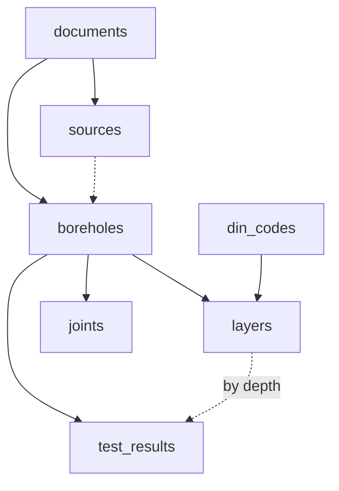

> **Design draft.** This is the early target data model written before the build. The implemented schema is the Alembic migrations in `backend/migrations/` and the models in `backend/app/db/models.py`; the API shape is [`contracts/openapi.yaml`](../../contracts/openapi.yaml).

# *Overview*
*How the tables relate. Solid arrow = one has many (foreign key). Dashed = linked without a foreign key.*

- `sources` points to one value of a borehole, layer or test result.
- A test result belongs to the layer whose `depth_from`–`depth_to` contains its `sample_depth`.


# *Conventions*
*Rules that apply to every table below.*
- Column names = **Herrenknecht names** from `Standards_Formats/BoreholeDataFormat.xlsx` in `snake_case`: space → `_`, all lowercase, `-` stays (`Surface Elevation` → `surface_elevation`, `X-Coordinate` → `x-coordinate`, `RQD` → `rqd`). Names with `-` must be quoted in SQL. Our own columns follow the same style.
- Table names: lowercase, plural.
- IDs: `uuid`. Foreign keys: `<table>_id`, e.g. `borehole_id`, `document_id`.
- Coordinates: always **WGS84** (EPSG:4326), `x-coordinate` = longitude, `y-coordinate` = latitude, in degrees. Coordinates as printed in the document go in `boreholes.local_x` / `local_y` (system in `coordinate_system`).


# *Core*
*The borehole data itself. Always needed.*

## boreholes
*HK Metadata, one row per borehole.*
```json
{
  "boreholes": [
    {
      "borehole_id": "33333333-3333-4333-8333-333333333333", // uuid
      "document_id": "11111111-1111-4111-8111-111111111111", // uuid|null; main source document, null without the optional part
      "borehole_name": "BH_AB01", // text
      "location_name": "Aberfeldie, Essendon", // text|null
      "start_date": "2014-08-05", // date|null
      "end_date": "2014-08-05", // date|null
      "project_id": "30041104", // text|null
      "project_name": "Water Main Drains Upgrade (Aberfeldie MD)", // text|null
      "country": "Australia", // text|null
      "client": null, // text|null; project owner
      "drilling_contractor": null, // text|null
      "driller_name": null, // text|null
      "surface_elevation": 35.7, // numeric|null; m above sea level of the ground at the borehole
      "x-coordinate": 144.8996, // numeric|null; longitude
      "y-coordinate": -37.7522, // numeric|null; latitude
      "location_uncertainty": 5, // numeric|null; radius in m the true position lies within, drawn as a circle
      "coordinate_system": "EPSG:28355", // text|null; CRS printed in the document, null = not printed
      "local_x": 321456.2, // numeric|null; easting as printed; API: coordinates.local_x
      "local_y": 5823411.8, // numeric|null; northing as printed; API: coordinates.local_y
      "crs_status": "stated", // enum: stated | inferred | confirmed | unknown
      "borehole_depth": 12.0, // numeric|null; m, vertical depth of the hole
      "borehole_length": 12.0, // numeric|null; m, drilled length along the hole, > depth if inclined
      "casing_info": null, // text|null; casing diameter and depth, as printed
      "groundwaterlevel": 8.1, // numeric|null; m below ground where water was found
      "tbm_assessment": null, // jsonb|null; {cutter_abrasivity_risk, face_stability_risk, water_ingress_risk, recommended_tbm_mode}, null = not computed; API: tbm_engineering_assessment
      "notes": null, // text|null
      "created_at": "2026-10-17T09:01:41Z", // timestamptz
      "updated_at": "2026-10-17T09:01:41Z" // timestamptz
    }
  ]
}
```


## layers
*HK Logdata + SPT, one row per layer.*
Unique: `borehole_id`, `position`. Check: `depth_to > depth_from`
```json
{
  "layers": [
    {
      "layer_id": "44444444-4444-4444-8444-444444444444", // uuid
      "borehole_id": "33333333-3333-4333-8333-333333333333", // uuid
      "position": 2, // int; 1 = top layer
      "depth_from": 0.4, // numeric; m below ground
      "depth_to": 1.6, // numeric; m below ground
      "original_description": "SILTY CLAY, stiff, brown", // text|null; as printed, source language
      "english_lithology": "silty clay", // text|null; standardised English
      "din_code": "T", // text|null; material as DIN 4023 code -> din_codes (name, colour, pattern)
      "uscs_group": "CL", // text|null; Unified Soil Classification
      "strength": "stiff", // text|null; how hard, as printed ("stiff", "weak", "very dense")
      "weathering": null, // enum|null: w0 | w1 | w2_3 | w4 | w5; DIN 4023 weathering grade, fresh (w0) to turned into soil (w5)
      "jointing": null, // enum|null: jointed | highly_jointed; how cracked the rock is
      "wet": null, // boolean|null; wet although above the groundwater ("nass")
      "stratigraphic_name": null, // text|null; geological formation it belongs to ("Waitemata Group")
      "geologic_age": null, // text|null; when it formed ("Quaternary")
      "core": false, // boolean|null; a drill core was taken here (only then TCR / RQD exist)
      "total_core_recovery": null, // numeric|null; % of the drilled length that came out as core
      "rqd": null, // numeric|null; % of the core in pieces ≥ 10 cm, low = fractured rock
      "spt_n_value": null, // int|null; blows per 30 cm, null on refusal, never store 50
      "spt_raw": "50/30", // text|null; as printed
      "spt_refusal": true, // boolean|null; driving stopped before 30 cm
      "spt_increments": [50], // int[]|null; blows per increment
      "spt_penetration": 30, // numeric|null; cm reached; API: spt_penetration_cm
      "spt_depth": 1.0, // numeric|null; m below ground where the test started; API: spt_depth_m
      "created_at": "2026-10-17T09:01:41Z", // timestamptz
      "updated_at": "2026-10-17T09:01:41Z" // timestamptz
    }
  ]
}
```


## test_results
*HK Test Results (on samples), one row per sample / test depth. SPT is on `layers`. A layer can have several; its layer is the one whose `depth_from`–`depth_to` contains `sample_depth`.*
```json
{
  "test_results": [
    {
      "test_result_id": "55555555-5555-4555-8555-555555555555", // uuid
      "borehole_id": "33333333-3333-4333-8333-333333333333", // uuid
      "sample_name": "ES", // text|null; sample label as printed
      "sample_type": "soil", // enum|null: soil | water; DIN 4023 draws a box or an open triangle
      "sample_depth": 0.4, // numeric|null; m below ground
      "watercontent": null, // numeric|null; %, water in the soil
      "cosistency": null, // numeric|null; %, HK typo, likely = consistency_index
      "unitweight": null, // numeric|null; kN/m³, weight of the material
      "ucs": null, // numeric|null; MPa, pressure until rock breaks, main strength value
      "tensile_strength": null, // numeric|null; MPa, pull until rock breaks
      "cai": null, // numeric|null; Cerchar index, how much the rock wears down cutters
      "rmr": null, // numeric|null; 0–100, overall rock mass rating
      "q": null, // numeric|null; 0.001–1000, rock mass quality (Q-system)
      "gsi": null, // numeric|null; 0–100, how fractured / weathered the rock mass is
      "friction_angle": null, // numeric|null; °, how steep soil stands before sliding
      "cohesion": null, // numeric|null; kPa, how strongly grains stick together
      "grainsize-fines": null, // numeric|null; %, grains < 0.063 mm (silt + clay)
      "liquid_limit": null, // numeric|null; %, water content where clay turns liquid
      "plasticity_limit": null, // numeric|null; %, water content where clay starts to crumble
      "plasticity_index": null, // numeric|null; liquid_limit − plasticity_limit, high = sticky clay
      "consistency_index": null, // numeric|null; soft / stiff / hard state of clay
      "hydraulic_coefficient": null, // numeric|null; m/s, how fast water flows through
      "e-modulus": null, // numeric|null; MPa, stiffness, how much it deforms under load
      "poissons_ratio": null, // numeric|null; sideways expansion when compressed
      "created_at": "2026-10-17T09:01:41Z", // timestamptz
      "updated_at": "2026-10-17T09:01:41Z" // timestamptz
    }
  ]
}
```


## joints
*Orientation of joints (cracks) in rock, one row per measurement. Printed like `135/25`.*
Check: `dip_direction` 0–360, `dip` 0–90
```json
{
  "joints": [
    {
      "joint_id": "66666666-6666-4666-8666-666666666666", // uuid
      "borehole_id": "33333333-3333-4333-8333-333333333333", // uuid
      "depth": 12.4, // numeric; m below ground where it was measured; API: depth_m
      "dip_direction": 135, // numeric; °, compass direction the plane tilts down towards (135 = SE); API: dip_direction_deg
      "dip": 25, // numeric; °, how steep, 0 = flat, 90 = vertical; API: dip_deg
      "created_at": "2026-10-17T09:01:41Z", // timestamptz
      "updated_at": "2026-10-17T09:01:41Z" // timestamptz
    }
  ]
}
```


## din_codes
*Lookup list from DIN 4023: what a code means and how to draw it. Filled once, not extracted.*
Unique: `din_code`
```json
{
  "din_codes": [
    {
      "din_code": "T", // text; DIN 4023 short form
      "kind": "soil", // text; soil | rock | geological
      "name_de": "Ton", // text
      "name_en": "Clay", // text
      "colour": "#675181", // text|null; DIN 4023 colour
      "pattern": "soil_T" // text|null; file in code/din_patterns (2023/<pattern>.svg symbol, tiles/<pattern>.svg with colour), see its README
    }
  ]
}
```


# *Optional:*
*Where each value came from (file, page, spot on the page). The core tables work without it.
Can be structured differently.*

## documents
*Every uploaded file: PDF, scan, image, docx.*
Unique: `sha256`
```json
{
  "documents": [
    {
      "document_id": "11111111-1111-4111-8111-111111111111", // uuid; = file name in document_bucket
      "file_name": "fictional-report.pdf", // text
      "mime_type": "application/pdf", // text
      "sha256": "9f2c...e1", // text; file hash, same file twice = same document
      "page_count": 14, // int
      "status": "needs_review", // enum: queued | classifying | extracting | needs_review | done | failed
      "error": null, // text|null; why it failed
      "expected_borehole_names": ["NM-101", "NM-102"], // jsonb|null; IDs the report lists, for the completeness check
      "created_at": "2026-10-17T09:00:00Z" // timestamptz
    }
  ]
}
```

## document_bucket
*Local file storage (no cloud) with the original files: `storage/document_bucket/<document_id>.pdf`.*

## sources
*One row per extracted value: which document, which page, which spot, what was printed, what the AI made of it, how sure it is.*
Points to exactly one of `borehole_id` | `layer_id` | `test_result_id`.
Unique: target + `target_column` where `selection = 'accepted'`
Corrected = the value in the data table differs from `extracted_value` of the accepted source.
```json
{
  "sources": [
    {
      "source_id": "22222222-2222-4222-8222-222222222222", // uuid
      "document_id": "11111111-1111-4111-8111-111111111111", // uuid
      "page_no": 2, // int
      "bbox": { "x0": 0.12, "y0": 0.81, "x1": 0.38, "y1": 0.83 }, // jsonb|null; spot on the page, 0–1 of page width / height
      "borehole_id": "33333333-3333-4333-8333-333333333333", // uuid|null; value belongs to this borehole
      "layer_id": null, // uuid|null; … or to this layer
      "test_result_id": null, // uuid|null; … or to this test result
      "target_column": "borehole_depth", // text; column the value belongs to
      "raw": "BOREHOLE BH_AB01 TERMINATED AT 12.00 m", // text; as printed, never edited
      "extracted_value": 12.0, // jsonb; as the AI parsed it, already in m / WGS84, never edited
      "confidence": 0.93, // numeric; 0–1, how sure the AI is
      "method": "ocr", // enum: read | ocr | derived | guessed | edited
      "review_status": "unreviewed", // enum: unreviewed | approved | flagged
      "state": "ok", // enum: ok | not_in_source | illegible; why a value is empty
      "flag_reason": null, // text|null; e.g. "datum unclear"
      "corrected_by": null, // text|null; who changed the value in the data table, null = not corrected
      "corrected_at": null, // timestamptz|null
      "selection": "accepted", // enum: candidate | accepted | rejected; contradicting values side by side, max. one accepted (was: status)
      "created_at": "2026-10-17T09:01:41Z" // timestamptz
    }
  ]
}
```
