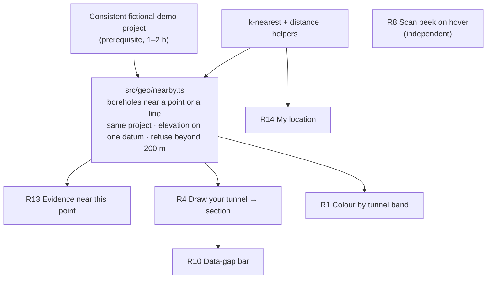

# Extra features: what we build, what waits, what we dropped

**Decided:** Sat 17 Oct 2026, based on the [map feature research](2026-10-17-map-feature-research.md) (49 sources) and the team's review.
**Scope:** the 14 extra map and subsurface ideas (R1–R14) beyond the original app. The original app features are tracked in [../feature-status.md](../feature-status.md).

## At a glance

| | ID | Feature | Decision | Effort |
|---|---|---|---|---|
| ✅ | R14 | My location on site | **Built** | 3–4 h |
| ✅ | R8 | Scan peek on hover | **Making** | 2–4 h |
| ✅ | R13 | Evidence near this point | **Making** (lite) | 6–9 h |
| ✅ | R4 | Draw your tunnel → section | **Making** (lite) | 6–8 h after R13 |
| ✅ | R10 | Data-gap bar | **Making** (inside R4) | +2–3 h |
| ✅ | R1 | Colour by tunnel band | **Making if time** (lite) | 3–5 h |
| 🔵 | R2 | 3D borehole sticks | Later | 12–20 h |
| 🔵 | R7 | Similar-ground finder | Later | 5–8 h |
| 🔵 | R9 | Ask the map (natural language) | Later | 6–10 h |
| 🔵 | R11 | One-click tender brief PDF | Later | 12–16 h |
| ❌ | R3 | Drill-down flythrough | Dropped | – |
| ❌ | R5 | TBM simulator / cutter-wear meter | Dropped | – |
| ❌ | R6 | Ground-risk heatmap | Dropped | – |
| ❌ | R12 | AR on a phone | Dropped, replaced by R14 | – |

## How the making-features fit together

Four of them are one engine: **find the real boreholes near a point or a line, and refuse where there is no evidence.** Build the engine once and test it, then add the views on top.

## Build order

| Step | What | Effort | Why this order |
|---|---|---|---|
| 0 | R14 My location (with the World / Country dropdown) | ✅ done | Built; it also delivered the distance helpers (`src/geo/nearest.ts`) |
| 1 | Consistent fictional demo project | 1–2 h | The current sample boreholes are generated independently, so neighbours look random and every section would look broken |
| 2 | R8 Scan peek on hover | 2–4 h | Cheapest, high demo value, no dependencies |
| 3 | `nearby.ts` engine + R13 | 6–9 h | Everything after this reuses the engine |
| 4 | R4 section + R10 gap bar | 8–11 h | The highest-value feature, built on step 3 |
| 5 | R1 Colour by tunnel band | 3–5 h | Only if time is left before the Sun 00:00 feature freeze |

## ✅ Making

### R14 · My location on site *(built; replaces R12 AR)*
- **What the engineer sees:** tap **MY LOCATION**. The map switches to their country and zooms to them, with a blue dot and an accuracy circle ("±6 m"). A **NEAR YOU** panel lists the 5 nearest boreholes with distance and direction ("BK-07 · 140 m · NE"). If nothing is within 2 km, it says so.
- **Why it's in:** on site, the question is "which borehole am I standing next to?". That needs metres, not AR-grade anchoring, and phone GPS gives about ±5 m.
- **Guardrails:**
  - It only works over HTTPS or on localhost (a browser rule).
  - Laptops locate by Wi-Fi, so expect tens to hundreds of metres.
  - The position never leaves the browser.
  - Sample mode can simulate being on site for the pitch.
- **Known limit:** the layout is desktop-first (1280 px), so phones need a responsive pass later.

### R8 · Scan peek on hover
- **What the engineer sees:** hover a pin and a thumbnail of the original scan appears, cropped to the borehole header. The method badge (Read / OCR / Guessed) shows, and "box not found: page shown" when the box can't be located.
- **Why it's in:** provenance is the one need all five personas share. This puts it on the map at no theory risk, because it shows the source and estimates nothing.

### R13 · Evidence near this point *(lite; the answer to "can we predict the ground here?")*
- **What the engineer sees:** click any point. An **"Evidence near this point"** panel shows the **3 nearest real boreholes** of the same project side by side, with:
  - each one's distance and direction
  - the **range** of rock head and groundwater across them (e.g. "rock head reached in 2 of 3: 212.4–214.1 m; BK-09 ended in soil at 18.0 m")
  - an "Indicative: nearest evidence, not a prediction" label, always visible
- **It refuses** when:
  - the nearest borehole is more than **200 m** away (the upper end of EN 1997-2's spacing guidance for tunnels), or
  - the point is outside the investigated area.

  Refusals are worded like "No borehole within 200 m. Nearest: BK-07 at 640 m."
- **Why not a real prediction:**
  - Across projects (km apart) it can't be defended.
  - Inside a project, geostatistics needs on the order of **100+ boreholes**, and we have 4–14.
  - National models that offer "synthetic boreholes" (Dutch GeoTOP, BGS LithoFrame) sample 3D models built by geologists from dense national databases.
- **Who it helps:** tender-phase screening at Herrenknecht. What does the client's data say here, how sure is it, and what should we ask for?

### R4 · Draw your tunnel → longitudinal section *(lite)*
- **What the engineer sees:**
  1. They draw a line on the map and set a corridor (±100 m) and the tunnel band (crown and invert).
  2. Every borehole in the corridor appears as a DIN 4023 column along the line, with its offset and a source link.
  3. Each hole gets flags: **rock head inside the band (mixed face here)**, **refusal in band**, **water above crown**, **doesn't reach invert**.
- **No interpolated lines between holes.** That's the geologist's interpretation, and drawn by a tool it could end up in a tender as a contractual baseline. A footer states the coverage: "9 of 12 holes placed; 3 without elevation".
- **Why it's in:** the highest value of all ideas. The DAUB TBM-selection recommendations start from the longitudinal section, and 4 of 5 personas asked for it.

### R10 · Data-gap bar *(inside R4)*
- **What the engineer sees:** a bar under the section marking stretches with **no borehole within 200 m** of the line, plus "no borehole reaches the invert here" marks. Gaps can go straight into the open-questions export for the client.
- **Cut from the original idea:** "drill here next" suggestions. Choosing drill sites is site-investigation planning by a qualified engineer.

### R1 · Colour by tunnel band *(lite depth slider, if time)*
- **What the engineer sees:** a "Colour by" option recolours each pin by what **that borehole** shows inside the tunnel band. There are six classes: soil · rock · **mixed face here** · refusal · not reached · no datum.
- **Why not a "depth slice":**
  - "10 m below ground" isn't a geological layer, and tunnels are designed in elevation.
  - A borehole that stops short says nothing about deeper ground.
  - The band works in elevation when all holes share a stated datum. Otherwise it falls back to depth, with a warning.

## 🔵 Later

| ID | Feature | Why not now |
|---|---|---|
| R2 | 3D borehole sticks | No persona asked for 3D. Leaflet is 2D only, so it would need a second map engine (MapLibre + deck.gl or Cesium), and WebGL in CI is a build risk for the code judge |
| R7 | Similar-ground finder | Only useful with project outcomes (TBM type used, cutter consumption), which the schema doesn't have. Layer sequences from different standards (DIN, USCS, BS) don't compare cleanly |
| R9 | Ask the map (natural language → filters) | Structured LLM output is guaranteed to be *valid*, not *correct*: a well-formed but wrong filter is a silent trust failure. It's also a live-API risk during the pitch. Filter chips do the same job |
| R11 | One-click tender brief PDF | The full version needs a project summary, ground class and tunnel horizon (12–16 h). A print view of the R4 section is the cheap version |

## ❌ Dropped

| ID | Feature | Why |
|---|---|---|
| R3 | Drill-down flythrough | Eye candy. No engineer, standard or tool treats a camera dive as a work step |
| R5 | TBM simulator / cutter-wear meter | The real wear models (CSM, NTNU, Gehring) need CAI, UCS, CLI and machine data, and **no lab values reach our app yet**. A cartoon wear meter in front of Herrenknecht engineers says we don't understand their job |
| R6 | Ground-risk heatmap | It interpolates a made-up score across sparse, mixed-standard data, and a coloured pixel has no source page, the opposite of our promise. Per-borehole flags in R4 do the honest version |
| R12 | AR on a phone | Phone GPS is about ±5 m, AR anchoring needs ≤ 10 m and ≤ 15° heading, and iPhones have no web AR. **Replaced by R14 My location**, which needs only the accuracy GPS already gives |

## Ground rules for every map feature

1. **Show evidence, never invent ground.** No interpolated surfaces or lines between boreholes.
2. **Elevation, not depth,** when comparing boreholes, and only on one stated datum.
3. **Never mix projects** in any spatial calculation.
4. **Refuse loudly** where there's no evidence (beyond 200 m, outside the investigated area, no datum).
5. **Every number links to its source page.**

## Pitch: what to say and what not to say

**Say:**
- "We don't invent a profile. We show the nearest logged evidence, its spread and its distance."
- "Beyond 200 m, the EN 1997-2 spacing ceiling for tunnels, we say there's no data, and that gap goes into the client question list."
- "Mixed face is flagged where the rock head sits inside the tunnel band at a borehole."

**Don't say:** "we predict the geology", "mixed face along the tunnel", "cutter wear estimate", "risk map", "SPT refusal = rock". The full list of 12 is in [§4 of the research report](2026-10-17-map-feature-research.md#4-things-we-should-not-claim-in-the-pitch).
