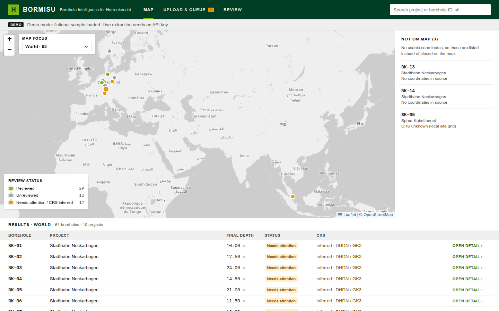
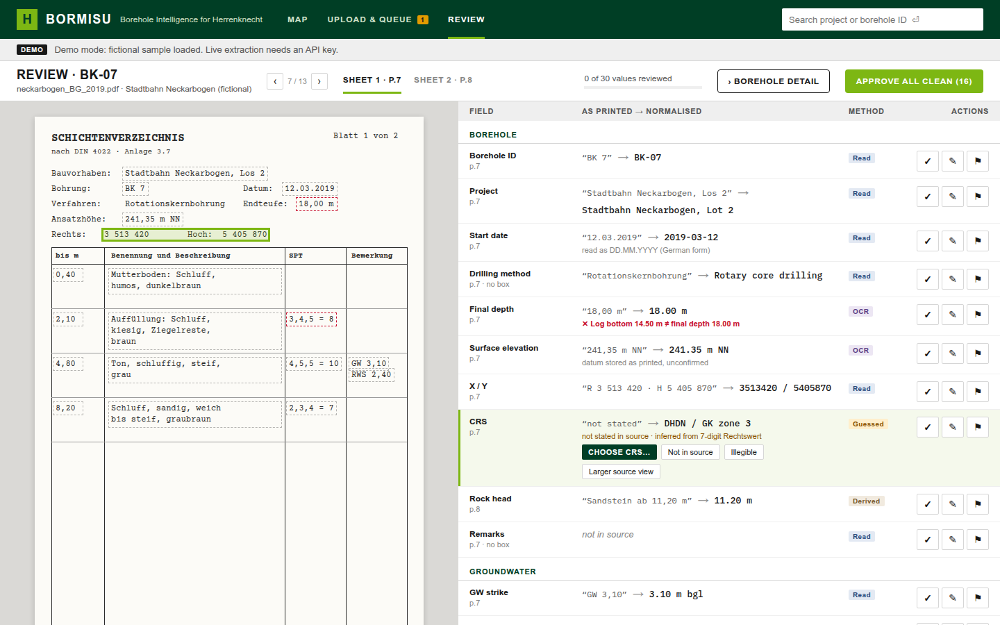
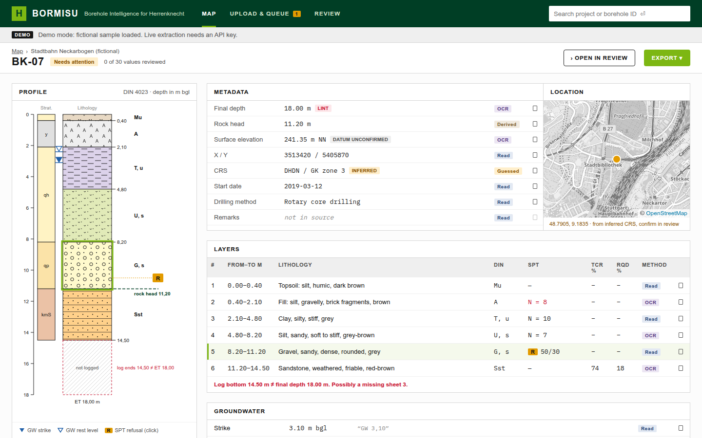

# Bormisu frontend

Bormisu turns messy geotechnical reports into reviewed borehole data. This is its web app:

- **Upload & queue:** drop PDFs, DOCX files or images. Watch each document go from *classifying* to *extracting* to *needs review*, with a page map and a completeness check (boreholes the report names but no log was found for).
- **Review:** every extracted value sits next to the scanned page with its box highlighted, shown as printed and as normalised, with its method (Read, OCR, Derived, Guessed, Edited). You can approve, edit (the AI value stays visible, struck through), flag, mark "not in source" or "illegible", approve all clean values at once, and confirm the coordinate system once for the whole report on a map preview.
- **Map:** boreholes coloured by review status. Boreholes without usable coordinates are listed under *Not on map* instead of being guessed onto it. Search by borehole ID or project.
- **Borehole detail:** the DIN 4023 profile (soil patterns, stratigraphy, groundwater, SPT refusals, rock head, the part of the hole that wasn't logged), metadata with provenance, layers, groundwater, a location map, and exports.

React 19 + TypeScript + Vite, zustand for state, Leaflet for maps, exceljs for the xlsx export.

| Map | Review | Borehole detail |
|---|---|---|
|  |  |  |

*Screenshots use the fictional sample data (`npm run dev:sample`).*

## Quick start

Needs Node 22.12 or newer (`.nvmrc`).

```bash
npm ci
npm run dev:sample   # demo mode: fictional sample data, no backend needed → http://localhost:5173
```

With the backend (FastAPI, API contract in `../contracts/openapi.yaml`):

```bash
npm run dev          # API mode: proxies /api to http://127.0.0.1:8000
VITE_API_PROXY=http://127.0.0.1:9000 npm run dev   # backend on another port
```

In API mode the app never falls back to sample data. Without a backend it shows *NO DATA: Cannot reach the Bormisu backend at /api/v1…* with a RETRY button. If an endpoint is missing it shows *Backend endpoint not available: GET /api/v1/…*.

## Sign-in

When the backend has sign-in (its `GET /api/v1/health` answers `auth: {enabled: true, …}`, contract 1.3.0), the app asks who is signed in before loading anything. Without a session it shows the sign-in screen on the URL you opened; after signing in you land on that URL.

- **Create account** appears when the backend keeps registration open. The **first account becomes admin**; later ones are reviewers. Passwords need 10 to 128 characters, must not be your email and must not be a common password (the form checks the first two, the server judges all three).
- The session is an HttpOnly cookie set by the backend; the frontend never sees a token and adds no header.
- The header shows your display name (or email). Its menu has your email and role, **Change password** (your other sessions are signed out) and **Sign out** (the data loaded in this tab is forgotten; the URL stays).
- When the session ends (expired, or signed out elsewhere), the next request answers 401 and the sign-in screen says "Your session ended. Sign in again."; you return to the same page afterwards.
- Signed in, the backend records you on every confirmation and answer, so the "Your name" setting is not shown. Without sign-in on the backend (and in sample mode) nothing changes: no sign-in screen, the optional "Your name" setting as before.

## Data source flag

The data source is chosen once, in `src/data/createDataSource.ts`, from `VITE_DATA_SOURCE`:

| Value | Where data comes from | How to get it |
|---|---|---|
| `api` (default) | the FastAPI backend under `VITE_API_BASE` (default `/api/v1`) | `npm run dev`, `npm run build` |
| `sample` | fictional demo data in `src/sample/`, in memory; uploads are simulated | `npm run dev:sample` (loads `.env.sample`) |

Sample mode shows a *DEMO* banner that can't be dismissed. The sample data is made up: no file in this repo comes from the challenge dataset. Only `createDataSource.ts` imports `src/sample/`, lazily and behind the flag, so an API build contains no sample data at all; `npm run check:dist` proves it for every build. See [.env.example](.env.example) for the variables. The frontend holds no API keys.

## Configuration

Build-time settings, read once in `src/config.ts`. They end up in the public JavaScript, so none of them may be a secret. Locally they come from `.env.local`; in Docker they are build args.

| Variable | Default | What it sets |
|---|---|---|
| `VITE_APP_NAME` | `Bormisu` | Product name in the header and the browser tab |
| `VITE_TILE_URL` | OpenStreetMap standard tiles | Basemap tile URL template (`{z}/{x}/{y}`) for every map |
| `VITE_TILE_ATTRIBUTION` | the OpenStreetMap attribution | Attribution HTML the tile source requires; set it with `VITE_TILE_URL` |
| `VITE_DATA_SOURCE` | `api` | `api` or `sample` (dev and tests only; Docker always builds `api`) |
| `VITE_API_BASE` | `/api/v1` | API base path as the browser sees it |
| `VITE_API_PROXY` | `http://127.0.0.1:8000` | Dev server only: where `/api` is proxied |

The OpenStreetMap tile servers suit light use only; for heavier use point `VITE_TILE_URL` at another tile source.

## Docker

`Dockerfile` builds the web image from the **repository root** (the DIN 4023 patterns live in `../assets/din4023_patterns`); compose runs it as the `web` service.

```bash
docker build -f frontend/Dockerfile -t bormisu-web .            # from the repository root
docker build -f frontend/Dockerfile --build-arg VITE_APP_NAME="Borehole Desk" \
  --build-arg VITE_TILE_URL="https://tiles.example.org/{z}/{x}/{y}.png" \
  --build-arg VITE_TILE_ATTRIBUTION="© Example Tiles" -t bormisu-web .
```

- **Stage 1** (`node:22-alpine`): `npm ci`, then `npm run build` in API mode (`VITE_DATA_SOURCE=api`, `VITE_API_BASE=/api/v1`) and `npm run check:dist`, which fails the build if sample data got in. `Dockerfile.dockerignore` sends only `frontend/` and `assets/din4023_patterns/` and never any `.env` file.
- **Stage 2** (`nginx:1.30.6-alpine`): serves `dist/` with `nginx.conf`. No keys or secrets are in the image.
- **nginx:** client-side routes fall back to `index.html` (deep links work); hashed `/assets/` are cached for a year, `index.html` is revalidated; text, JSON, SVG and GeoJSON are gzipped. `/api/` goes to the API with a 200 MB upload limit (the request body may be 201 MB, for the multipart framing around a file just under the limit; a larger upload gets the API's JSON 413, `code: too_large`). `/api/v1/events` and `/api/v1/chat` stream unbuffered with an hour's read timeout.
- **API upstream:** `API_UPSTREAM` (default `http://api:8000`, scheme, host and port only) and `API_RESOLVER` (default `127.0.0.11`, Docker's DNS) are read at container start. The host is resolved per request, so the web container starts and serves the app while the API is down; `/api` then answers 502 and the app shows "backend unreachable".
- **Health check:** `GET /healthz` inside the container.

```bash
docker run --rm -p 8080:80 --network <compose network> bormisu-web     # needs an "api" host on that network
docker run --rm -p 8080:80 -e API_UPSTREAM=http://host.docker.internal:8000 bormisu-web
```

## Scripts

| Script | What it does |
|---|---|
| `npm run dev` | Vite dev server, API mode |
| `npm run dev:sample` | Vite dev server, sample mode |
| `npm run build` | Type check (`tsc -b`, including the e2e tests) and production build to `dist/` |
| `npm run check:dist` | Fails if `dist/` (or the folder given) contains sample data or a sample chunk |
| `npm run preview` | Serves the production build |
| `npm test` | Vitest unit tests |
| `npm run e2e` | Playwright: the `sample` project (sample mode, the config starts the dev server); with `E2E_BASE_URL` set, the `api` project against a running stack instead. System Chrome locally, bundled Chromium when `CI` is set |
| `npm run gen:api` | Regenerates `src/data/api-types.gen.ts` from `../contracts/openapi.yaml` (openapi-typescript 7.13.0); CI fails when the committed file differs |

## Folder overview

```
src/
  App.tsx              shell: header, demo banner, active screen, side panel, CRS dialog, toast
  schema/              the Herrenknecht standard format, defined once (targetFormat.ts)
  domain/              types, value keys, pure review / SPT / number-format logic
  data/                DataSource interface, API client + adapters, the api|sample switch
  sample/              DEMO ONLY fictional data (sample mode)
  store/               zustand store: all state and actions (optimistic review edits)
  components/          shared UI: header, panels, scan page, chips, badges, Leaflet helpers
  screens/             map/, queue/, review/, detail/: one folder per screen
  export/              standard xlsx, tidy CSV, open-questions CSV
  styles/tokens.css    design tokens (colours, fonts) and global styles
e2e/                   Playwright: sample-mode specs; e2e/api/ against a running stack (E2E_BASE_URL)
```

[ARCHITECTURE.md](ARCHITECTURE.md) is the binding spec: domain types, value keys, the DataSource interface, the store API and the hard rules. Read it before changing code.

## Export and the Herrenknecht standard format

Exports run in the browser from the reviewed data, so API and sample mode share one code path. Open a borehole and use **EXPORT ▾**. An export covers every borehole of that borehole's report.

**Project xlsx (target format)** follows `BoreholeDataFormat.xlsx`. Field names, order, formats and units come from `src/schema/targetFormat.ts` and nowhere else.

| Sheet | One row per | Columns |
|---|---|---|
| `Metadata` | borehole | the 14 metadata fields (BoreholeID … Notes) |
| `Logdata` | layer | `BoreholeID`, `DepthFrom`, `DepthTo`, then the 12 log-data fields |
| `Test Results` | sample | `BoreholeID`, `SampleName`, `SampleDepth`, then the 19 test-result fields (header only for now) |
| `Provenance` | exported value | `BoreholeID`, key, field, raw (as printed), value, unit, page, method, status, state |

- Row 1 holds the template field names and row 2 the units, so the sheets line up with the template.
- **Approved values only, by default.** Unreviewed values are left blank, and a blank never means 0. The BoreholeID column always carries the ID, so every row can be joined across sheets.
- **Include unreviewed values** exports everything, adds a `DRAFT – NOT APPROVED` title row above the header, and adds `_DRAFT` to the file name.
- **Mapping details:**
  - Numeric fields are written as numbers.
  - "Not in source" and "illegible" values are blank.
  - The single X / Y value is split into `X-Coordinate` and `Y-Coordinate`.
  - An SPT refusal keeps its raw text (e.g. `50/30`, never N = 50), and a regular SPT is written as its N.
  - Groundwater goes to the layer row that contains its depth.
  - `StratigraphicName` and `Soil/Rockprofile` come from the layer's stratigraphy code and DIN 4023 code.

**Tidy CSV:** one row per value (borehole, field, layer, raw, value, unit, page, method, status, state), UTF-8 with a BOM so Excel reads umlauts.

**Open questions (CSV):** the list of questions for the client: boreholes the report names but no log was found for, coordinate system not stated (or unknown), lint findings, flags and illegible values.

## Testing

```bash
npm test         # unit tests: domain rules, schema, API adapters + error handling, sample data,
                 # store flows (approve all clean, edit vs flag, states, CRS confirmation, search,
                 # uploads, export scope), xlsx/CSV builders, screen view models
npm run e2e      # Playwright project "sample": sample mode, system Chrome; PORT sets the dev server port (default 5174)
E2E_BASE_URL=http://localhost:8081 npm run e2e -- --project=api   # Playwright project "api" against a seeded compose stack
npm run gen:api && git diff --exit-code src/data/api-types.gen.ts   # generated wire types match the contract
```

`playwright.config.ts` defines two projects; which one exists depends on `E2E_BASE_URL`. Both stub the map tiles (they run offline) and fail a test on any console error. In CI (`CI` set) they use Playwright's bundled Chromium (`npx playwright install --with-deps chromium`), locally the installed Chrome.

**`sample`** (`e2e/*.spec.ts`; `E2E_BASE_URL` unset): the config starts `npm run dev:sample` on 127.0.0.1:`$PORT` and stops it afterwards. `npm run e2e` and `npx playwright test --project=sample` run it. It covers:

- **Map:** pins, legend counts, no pin under the legend in the first view, the *Not on map* list, a results row and a pin popup opening the detail, and search ("EQ-03" flies to the pin; "BK-13" explains why it isn't on the map).
- **Detail:** the profile; the R marker opens the source panel with the highlighted box; the tidy CSV downloads; the standard xlsx downloads, and its sheets and row-1 field names are checked with exceljs.
- **Queue:** three documents; the completeness panel lists BK-12 as missing; a `.txt` upload shows the red error; a `.pdf` upload adds a simulated document that goes through the steps.
- **Review:** approve all clean updates the progress; an edit keeps the AI value struck through; flag and un-flag; state buttons toggle; confirming the CRS turns the Neckarbogen pins from amber.
- **Accessibility:** focus trap and focus return of the dialogs, live regions, DIN 4023 pattern fills.

**`api`** (`e2e/api/**/*.spec.ts`; only when `E2E_BASE_URL` is set): runs against an app that is already running in API mode; no dev server is started. Start the compose stack from the repository root with the fictional seed, then point `E2E_BASE_URL` at the stack's web port (the `web` service; `WEB_PORT` in the stack's `.env`, e.g. 8081):

```bash
docker compose up --build -d                     # repository root: db, api, worker, web
docker compose exec api python -m app.seed       # fictional documents and boreholes
E2E_BASE_URL=http://localhost:8081 npm run e2e -- --project=api
E2E_BASE_URL=http://localhost:8081 npx playwright test --project=api e2e/api/review.spec.ts   # one spec
```

- `e2e/api/auth.spec.ts` plays a sign-in backend with Playwright routes (the stack itself may still have no sign-in). Once the backend ships sign-in, `E2E_AUTH=1` makes `e2e/api/auth-session.ts` register a fictional account (`e2e-<timestamp>@example.test`) per worker and start each page with its session.
- The specs share the seeded database: one worker, in file order. They read the seed state from the backend (no hard-coded ids), change review data and put it back afterwards (through the API where the UI can't). Each spec names the seed state it needs at its top.
- Some changes can't be undone: a confirmed CRS stays confirmed, an edited value keeps the method `edited`, and each run uses up one seeded CRS document. Reseed for a pristine stack: `docker compose exec api python -m app.seed --remove && docker compose exec api python -m app.seed`.
- `knownBug(id)` marks a test that fails because of a reported finding (it counts as an expected failure); `E2E_SHOW_KNOWN=1` runs it as a normal test to show the real failure. A failing test writes every `/api/` response next to its results as `api-log.json`.

**Generated types:** `npm run gen:api` regenerates `src/data/api-types.gen.ts` from `../contracts/openapi.yaml`. After a contract change, run it and commit the result; with no contract change, `git diff --exit-code src/data/api-types.gen.ts` stays empty (CI runs exactly this).

`.github/workflows/frontend.yml` runs the unit tests, `gen:api` with the diff check, the build, `check:dist`, the `sample` e2e project and the Docker build. The `api` project needs the compose stack and runs locally.
