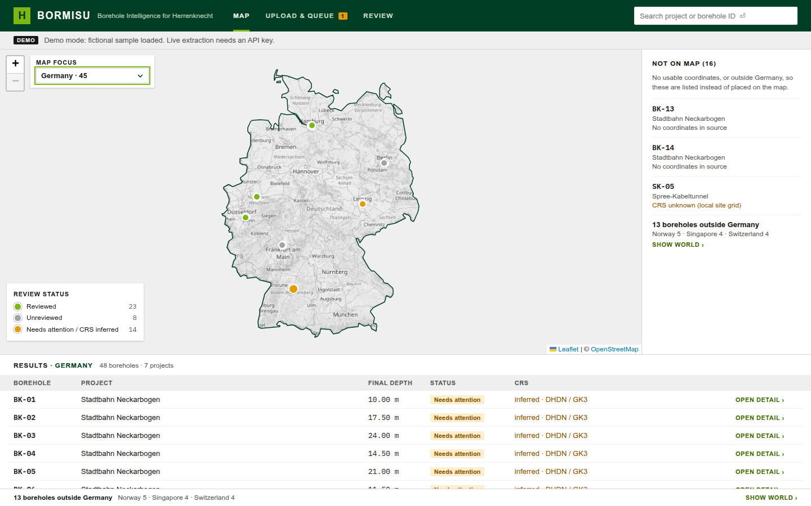
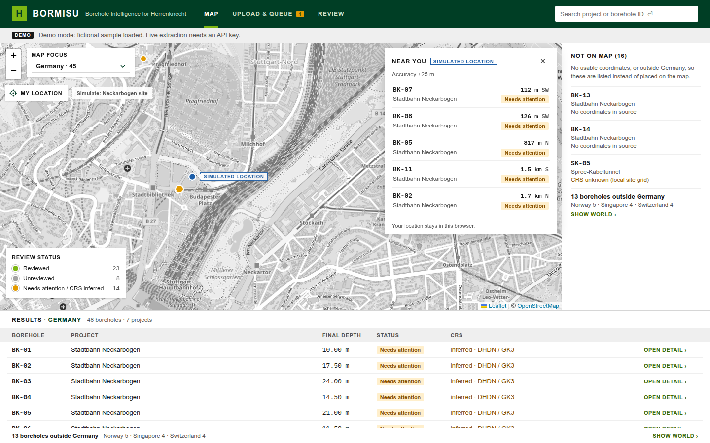

# Bormisu frontend

Bormisu turns messy geotechnical reports into reviewed borehole data for Herrenknecht. This is its web app:

- **Upload & queue:** drop PDFs, DOCX files or images. Watch each document go from *classifying* to *extracting* to *needs review*, with a page map and a completeness check (boreholes the report names but no log was found for).
- **Review:** every extracted value sits next to the scanned page with its box highlighted, shown as printed and as normalised, with its method (Read, OCR, Derived, Guessed, Edited). You can approve, edit (the AI value stays visible, struck through), flag, mark "not in source" or "illegible", approve all clean values at once, and confirm the coordinate system once for the whole report on a map preview.
- **Map:** boreholes coloured by review status, worldwide or for one country at a time (the *Map focus* dropdown; see [Map focus](#map-focus)). Boreholes without usable coordinates are listed under *Not on map* instead of being guessed onto it. Search by borehole ID or project; a result in another country switches the map there. On site, **MY LOCATION** lists the boreholes nearest to you (see [My location](#my-location)).
- **Borehole detail:** the DIN 4023 profile (soil patterns, stratigraphy, groundwater, SPT refusals, rock head, the part of the hole that wasn't logged), metadata with provenance, layers, groundwater, a location map, and exports.

React 19 + TypeScript + Vite, zustand for state, Leaflet for maps, exceljs for the xlsx export.

| Map (World) | Map (one country) | My location (simulated) |
|---|---|---|
|  |  |  |

| Review | Borehole detail |
|---|---|
|  |  |

*Screenshots use the fictional sample data (`npm run dev:sample`).*

## Quick start

```bash
npm install
npm run dev:sample   # demo mode: fictional sample data, no backend needed → http://localhost:5173
```

With the backend (FastAPI, see `docs/design/api-contract.md`):

```bash
npm run dev          # API mode: proxies /api to http://127.0.0.1:8000
VITE_API_PROXY=http://127.0.0.1:9000 npm run dev   # backend on another port
```

In API mode the app never falls back to sample data. Without a backend it shows *NO DATA: Cannot reach the Bormisu backend at /api/v1…* with a RETRY button. If an endpoint is missing it shows *Backend endpoint not available: GET /api/v1/…*.

## Data source flag

The data source is chosen once, in `src/data/createDataSource.ts`, from `VITE_DATA_SOURCE`:

| Value | Where data comes from | How to get it |
|---|---|---|
| `api` (default) | the FastAPI backend under `VITE_API_BASE` (default `/api/v1`) | `npm run dev`, `npm run build` |
| `sample` | fictional demo data in `src/sample/`, in memory; uploads are simulated | `npm run dev:sample` (loads `.env.sample`) |

Sample mode shows a *DEMO* banner that can't be dismissed. The sample data is made up: no file in this repo comes from the challenge dataset. Only `createDataSource.ts` imports `src/sample/`, lazily and behind the flag, so an API build contains no sample data at all. See [.env.example](.env.example) for the variables. The frontend holds no API keys.

## Map focus

Herrenknecht's projects span many countries, so the Map screen's map shows either the whole world or one country. The **MAP FOCUS** dropdown (top left, next to the zoom buttons) lists *World* and every country that has at least one borehole, with its count, e.g. *Germany · 45*, most boreholes first. It's a native select, so it works with the keyboard.

| Focus | Map screen |
|---|---|
| World | Every borehole with coordinates. No mask, no limits; the view fits all pins. |
| A country, e.g. Germany | Only that country's boreholes. Everything outside it is masked in the map background colour, with a thin dark-green border; the view can't pan or zoom out beyond it. The legend counts its pins, *RESULTS · GERMANY* lists its boreholes, and the boreholes elsewhere are one line (*13 boreholes outside Germany*) under *Not on map* and under the results, each with **SHOW WORLD**. |

- **Where the focus comes from:** `?focus=DE` or `?focus=world` in the URL, else `VITE_MAP_FOCUS` (a build-time preset, e.g. `DE`), else World. Every change updates `?focus=` without a reload, so a view can be shared as a link. An unknown code falls back to World. `.env.example` sets `world`; `.env.sample` leaves it unset (World).
- **Search:** a result in another country than the current focus switches the map to that country (to World when it lies in none), then flies there and opens the popup.
- **Which country a borehole is in:** point-in-polygon on the country outlines, after a bounding-box check. A point within 2 km outside an outline still counts, because the 1:50m outlines are generalised by about a kilometre (a borehole on the German bank of the Rhine must not drop off the Germany map, a harbour borehole must not fall into the sea). Near a border a borehole can therefore show in both countries. Boreholes in no country (offshore) show only in World.
- Boreholes without usable coordinates are listed under *Not on map* in every view. In a country's results they appear when their project has pins in that country (or none anywhere).
- The CRS dialog and the detail mini-map are never restricted.

The country outlines come from [Natural Earth](https://www.naturalearthdata.com/) 1:50m admin-0 countries, **public domain**: 237 countries and territories with an ISO code (1:10m outlines for 35 small island states such as Singapore, whose 1:50m outline is a rough octagon), simplified with a topology-preserving Douglas-Peucker at 0.01° so neighbouring countries keep identical borders, 3 decimals, rings stored as integer deltas. The file `src/geo/countries-50m.json` (about 590 kB, 235 kB gzipped) is not in the JavaScript bundle: Vite emits it as a hashed asset and the Map screen fetches it on first use. Its `source`, `license`, `simplification` and `encoding` fields describe it.

To rebuild it, download `ne_50m_admin_0_countries.geojson` and `ne_10m_admin_0_countries.geojson` from Natural Earth into an empty folder, then run `python3 -I scripts/extract_countries.py <ne_50m.geojson> src/geo/countries-50m.json 0.01 3 <ne_10m.geojson>`.

## My location

For engineers on site: **MY LOCATION** (under the map's zoom buttons) asks the browser for the position (`enableHighAccuracy`, 10 s timeout, a fix up to 30 s old is fine). The map switches to the country you are in (World at sea), flies to street level and draws a blue dot with the accuracy circle. The **NEAR YOU** panel shows the accuracy and the five nearest boreholes with distance (m below 1 km, else km), compass direction and review status; a row opens the borehole's detail. When even the nearest is more than 2 km away it says *No borehole within 2 km of you. Nearest: BK-07 at 3.4 km.* The panel closes with × or Escape.

- **Privacy:** the position stays in the browser. It is not sent to the backend, not saved and not put in the URL (the panel says so). An e2e test checks that no request and no URL contains it.
- **When it can't locate:** *Locating…* while waiting, then a clear message for a denied permission (*Location permission denied. Allow it in the browser to see boreholes near you.*), an unavailable position, a timeout, or a page without HTTPS (*Location needs HTTPS (or localhost).*).
- **Demo (sample mode only):** *Simulate: Neckarbogen site* next to the button, or `?simLocation=48.7912,9.1846` in the URL, pretends you are at that position; dot and panel then say *SIMULATED LOCATION*. In API mode neither exists.
- The helpers are pure and unit-tested in `src/geo/nearest.ts` (haversine distance, bearing → compass, k nearest, distance text) and `src/geo/geolocate.ts`, so a later "nearest evidence" feature can reuse them.
- **Phones:** the app layout has a minimum width of 1280 px, so phones need a responsive pass first. On a tablet the button and the panel work (the page scrolls sideways for the *Not on map* column).

## Scripts

| Script | What it does |
|---|---|
| `npm run dev` | Vite dev server, API mode |
| `npm run dev:sample` | Vite dev server, sample mode |
| `npm run build` | Type check (`tsc -b`, including the e2e tests) and production build to `dist/` |
| `npm run preview` | Serves the production build |
| `npm test` | Vitest unit tests |
| `npm run e2e` | Playwright smoke tests in sample mode, with the system Chrome |

## Folder overview

```
src/
  App.tsx              shell: header, demo banner, active screen, side panel, CRS dialog, toast
  schema/              the Herrenknecht standard format, defined once (targetFormat.ts)
  domain/              types, value keys, pure review / SPT / number-format logic
  data/                DataSource interface, API client + adapters, the api|sample switch
  sample/              DEMO ONLY fictional data (sample mode)
  store/               zustand store: all state and actions (optimistic review edits)
  components/          shared UI: header, panels, scan page, chips, badges, Leaflet helpers
  screens/             map/, queue/, review/, detail/: one folder per screen
  export/              standard xlsx, tidy CSV, open-questions CSV
  geo/                 map focus, country outlines (Natural Earth, lazy-loaded), country assignment, point-in-polygon,
                       distances / nearest boreholes, browser geolocation
  styles/tokens.css    design tokens (colours, fonts) and global styles
e2e/                   Playwright smoke tests
```

[ARCHITECTURE.md](ARCHITECTURE.md) is the binding spec: domain types, value keys, the DataSource interface, the store API and the hard rules. Read it before changing code.

## Export and the Herrenknecht standard format

Exports run in the browser from the reviewed data, so API and sample mode share one code path. Open a borehole and use **EXPORT ▾**. An export covers every borehole of that borehole's report.

**Project xlsx (target format)** follows `BoreholeDataFormat.xlsx`. Field names, order, formats and units come from `src/schema/targetFormat.ts` and nowhere else.

| Sheet | One row per | Columns |
|---|---|---|
| `Metadata` | borehole | the 14 metadata fields (BoreholeID … Notes) |
| `Logdata` | layer | `BoreholeID`, `DepthFrom`, `DepthTo`, then the 12 log-data fields |
| `Test Results` | sample | `BoreholeID`, `SampleName`, `SampleDepth`, then the 19 test-result fields (header only for now) |
| `Provenance` | exported value | `BoreholeID`, key, field, raw (as printed), value, unit, page, method, status, state |

- Row 1 holds the template field names and row 2 the units, so the sheets line up with the template.
- **Approved values only, by default.** Unreviewed values are left blank, and a blank never means 0. The BoreholeID column always carries the ID, so every row can be joined across sheets.
- **Include unreviewed values** exports everything, adds a `DRAFT – NOT APPROVED` title row above the header, and adds `_DRAFT` to the file name.
- **Mapping details:**
  - Numeric fields are written as numbers.
  - "Not in source" and "illegible" values are blank.
  - The single X / Y value is split into `X-Coordinate` and `Y-Coordinate`.
  - An SPT refusal keeps its raw text (e.g. `50/30`, never N = 50), and a regular SPT is written as its N.
  - Groundwater goes to the layer row that contains its depth.
  - `StratigraphicName` and `Soil/Rockprofile` come from the layer's stratigraphy code and DIN 4023 code.

**Tidy CSV:** one row per value (borehole, field, layer, raw, value, unit, page, method, status, state), UTF-8 with a BOM so Excel reads umlauts.

**Open questions (CSV):** the list of questions for the client: boreholes the report names but no log was found for, coordinate system not stated (or unknown), lint findings, flags and illegible values.

## Testing

```bash
npm test         # unit tests: domain rules, schema, API adapters + error handling, sample data,
                 # store flows (approve all clean, edit vs flag, states, CRS confirmation, search,
                 # uploads, export scope), xlsx/CSV builders, screen view models
npm run e2e      # Playwright, sample mode, system Chrome (channel: 'chrome'); PORT sets the port (default 5174)
```

The e2e suite starts `npm run dev:sample` itself and stops it afterwards. Map tiles are stubbed, so it runs offline, and every test fails on any console error. It covers:

- **Map:** pins, legend counts, the *Not on map* list, a results row and a pin popup opening the detail, and search ("EQ-03" flies to the pin; "BK-13" explains why it isn't on the map).
- **Map focus:** the dropdown lists World, Germany, Norway, Singapore and Switzerland with their counts; World is the default, without mask or zoom limit; Germany shows mask and border between the tiles and the pins, can't be zoomed out beyond, narrows legend, results and *Not on map*, and SHOW WORLD restores World; switching countries leaves no stray mask or border; the keyboard works; `?focus=DE` opens on Germany and `?focus=ZZ` falls back to World; searching a Singapore borehole from the Germany view switches to Singapore and opens its popup. A test moves one sample project into the North Sea (by patching the sample module in the browser, not the repo): it is plotted only in World, and searching for it from Germany switches to World.
- **My location:** with a granted position near BK-07 the map switches to Germany, draws the dot and accuracy circle, and NEAR YOU lists BK-07 first at 112 m SW; neither URL nor any request contains the position; Escape and × close the panel; a row opens the detail. Far away it names the nearest borehole; without permission it shows the denied message; `?simLocation=` and *Simulate: Neckarbogen site* show a *SIMULATED LOCATION*.
- **Detail:** the profile; the R marker opens the source panel with the highlighted box; the tidy CSV downloads; the standard xlsx downloads, and its sheets and row-1 field names are checked with exceljs.
- **Queue:** three documents; the completeness panel lists BK-12 as missing; a `.txt` upload shows the red error; a `.pdf` upload adds a simulated document that goes through the steps.
- **Review:** approve all clean updates the progress; an edit keeps the AI value struck through; flag and un-flag; state buttons toggle; confirming the CRS turns the Neckarbogen pins from amber.
